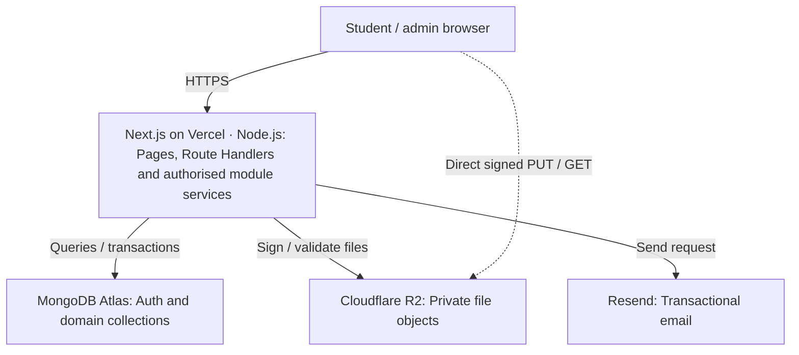

# PrepPilot System Design Document

Version 1.0  |  22 October 2026  |  Baseline: PRD v2.0

A modular monolith for placement preparation across DSA, aptitude and CS fundamentals. This document specifies the implementation boundaries, data model, API contracts and operating procedures for a solo, Codex-assisted build.

## 1 Design status and scope

The technology choices below are confirmed. The detailed defaults in this document are proposed implementation decisions, ready to use as the engineering baseline. No application code, deployment or provider account configuration has been completed by producing this document.

| Confirmed choices | Implementation baseline |
| --- | --- |
| Application | One Next.js App Router application; Node.js Route Handlers; REST; TypeScript in UI, backend, scripts and tests. No Express or NestJS. |
| Data and validation | MongoDB Atlas; Mongoose for application collections; Zod at all external boundaries. |
| Identity | Better Auth with its official MongoDB adapter; database-backed sessions in secure cookies. This library selection is a design recommendation. |
| Services | Vercel hosting; private Cloudflare R2 attachments; Resend transactional email. |
| Product | Students, admins and one owner; curated content; attempts, revisions, versioned plans and explainable adaptation. |

### Design goals

Make scheduling deterministic, preserve history and prevent duplicate or stale writes. Keep business logic independent of HTTP and UI. Fit a small portfolio pilot within free allowances where possible, without treating free tiers as unlimited capacity.

### Release dependencies

A verified sending domain is not yet available; R2 activation is unconfirmed. Implement both integrations behind server-controlled capability flags. A demo can run with explicitly limited email and attachments; a full pilot requires the live-service gates in section 15.

### Reading map

2–3: topology and modules · 4–5: identity and API rules · 6–7: data models · 8–9: scheduling and consistency · 10–11: endpoints · 12–13: files and email · 14–15: deployment and verification · 16: decisions and sources.

## 2 Runtime architecture

Solid arrows show server-mediated operations. The dashed path carries file bytes directly between the browser and R2 after server authorisation. MongoDB, R2 and Resend are never called using secret credentials from the browser.

### Request handling

Server Components call authorised query services for initial data. Client Components use REST for mutations and interactive refreshes. Route Handlers translate HTTP, validate with Zod, resolve the current actor and call services. Services enforce ownership and business rules; repositories own database queries.

All routes that access Mongoose, auth, R2 or Resend explicitly use the Node.js runtime. Do not place database access in an Edge path. Optional proxy redirects improve navigation only; every protected page query and endpoint performs real authorisation. [1–3]

### Deployment model

One repository and one Vercel project form one deployable application. Several function instances can run concurrently. In-memory locks, sessions and counters cannot coordinate requests across instances. Authoritative state belongs in Atlas; reusable connections are cached only within each warm instance.

### Consistency boundaries

Transactions coordinate related domain records inside MongoDB. Authentication uses library-managed transactions and collections. R2 and Resend are outside MongoDB transactions: their operations use explicit states, idempotency and compensating cleanup. Never call a provider from a transaction callback that may be retried.

### Deliberate limits

No separate worker, Redis, message broker, microservices or always-running Node server is required in v1. Revision due dates are calculated on writes and queried on demand. Admin-triggered maintenance handles orphans. Recurring reminders, code execution and large imports remain outside the release scope.

## 3 Module boundaries and repository layout

| Module / directory | Owns |
| --- | --- |
| identity | Auth adapter, actor resolution, role checks, verification gate and profile preferences. |
| catalog | Content, company/topic definitions, publication checks and catalog revision. |
| practice | Attempt submission, idempotency and outcome history. |
| revisions | One revision record per student/content pair; due dates and revision queries. |
| planning | Pure scheduling rules, preview persistence, confirmations and task state. |
| progress | Read-only aggregations of attempts, revisions and active-plan tasks. |
| files | R2 signing, finalisation, authorised download grants and cleanup. |
| notifications | Resend adapter, server-controlled email mode and delivery metadata. |
| administration | Admin use cases and audit events; calls catalog and file services. |

### Directory contract

| Path | Purpose |
| --- | --- |
| src/app/ | App Router pages, layouts and thin API route files. |
| src/modules/\<module\>/ | service.ts, repository.ts, model.ts, schemas.ts, types.ts; module-specific rule files and tests. |
| src/shared/server/ | Database clients, actor guards, CSRF, rate limits, errors, logging and environment validation. Mark server-only imports. |
| src/shared/ui/ | Reusable accessible UI components; no database or provider imports. |
| src/config/; scripts/ | Versioned company/topic templates; TypeScript seed, index, migration and admin-provisioning commands. |
| tests/integration/; tests/e2e/ | Replica-set integration tests and complete browser journeys. |

### Dependency rules

UI and routes depend on module services. Services may call another module’s public service interface; they must not write its collections directly. The planning engine accepts plain typed input and returns plain output, with no network or database calls. Shared code contains mechanisms, not study rules.

Use strict TypeScript, a committed lockfile and one package manager. Zod schemas infer request DTO types; explicit response DTOs prevent leaking Mongoose internals, answer keys in list responses or auth records. Add import-boundary lint rules where useful.

## 4 Identity, sessions and authorisation

### Authentication ownership

Use Better Auth with the official MongoDB adapter at /api/auth/[...all]. Pin a supported stable release and its compatible adapter. The library owns user, account, session and verification collections, password hashing and reset-token validation. Domain repositories must not define competing Mongoose models for these collections. [3–5]

The Profile collection references the library user ID as a string; it owns the role and preparation settings. Public signup cannot accept a role. Lazily and idempotently create a missing profile with role=student after authentication; a unique userId index handles races and makes signup/profile partial failure recoverable.

### Session policy — proposed defaults

Use database-backed sessions, HttpOnly cookies, Secure in production and SameSite=Lax with host-only scope. Set a seven-day rolling expiry with refresh no more than once a day. Disable cookie session caching and secondary session storage so protected requests consult the database. Check expiry during access; TTL cleanup is not an access-control check. [4]

Read the current Profile role on each protected request. Logout revokes the current session; password reset revokes all existing sessions and requires login. A changed role or revoked session must take effect on the next request. Never store auth tokens in localStorage or expose them in logs.

### Actor and access checks

| Guard | Required behaviour |
| --- | --- |
| requireActor | Validate session and ensure a Profile; return trusted userId, role and emailVerified state. |
| requireStudyActor | Also enforce verified email in live mode. Test mode explicitly allows unverified student demo access. |
| requireAdmin | Current active profile role admin or owner. Live mode also requires verified email. |
| requireOwner | Study access plus current active profile role owner; required for all administrator-management reads and writes. |
| Resource ownership | Query with both resource ID and actor.userId; return 404 for another student’s resource. |
| Owner provisioning | Explicit TypeScript operator preview/apply against an exact verified ID/email and selected development/test DB. Unique partial profile index permits at most one owner. Legacy direct admin grants retired. |

### Owner management amendment — 25 October 2026

The domain profile is the only role/ownership authority. One shared login routes
owner/admin to /admin and students to onboarding/dashboard. Student-only writes
remain student-only. No cached role authorizes a request. Demoted accounts use
their existing preferences, or onboarding when incomplete, without history erasure.

Identity exposes minimal canonical auth-identity reads to Administration; no
competing auth models or password storage. Password confirmation calls the pinned
Better Auth server-only verifyPassword API. Store only a session-ID digest, user ID,
confirmation time and five-minute expiry in adminReauth; never store the password
or a duplicate session token. Check live session and proof expiry on mutations.
Five confirmation attempts per account per 15 minutes bound failed attempts too.

Role mutations recheck/lock the acting owner profile inside the domain transaction,
then conditionally update one target profile, append audit and retain an idempotent
operation record. Actor profile lock precedes target profile, then dependent records;
only one owner can initiate these operations, avoiding two-owner lock inversions.
Target stateRevision advances once per transition, invalidating pending previews.
Current session authorization is revalidated independently through Better Auth;
do not claim the domain transaction contains an auth-library transaction.

Public auth allowlisting still excludes delete-user, role edits and password
verification routes. No erasure/deactivation implementation currently exists;
any future operator erasure must refuse role=owner and use separate ownership
recovery/transfer procedures. General-user delivery remains blocked pending a
verified sender; demo study access never bypasses verified-target promotion.

### CSRF and browser protection

Keep the auth library’s origin/CSRF checks enabled. Application writes require an exact allowed Origin, JSON content type and an X-CSRF-Token. Issue a short-lived HMAC-signed token bound to the validated session ID through GET /api/v1/security/csrf; verify signature, session binding and expiry before each write. Reject missing headers and cross-origin requests. Use cryptographic library primitives, not custom algorithms.

Verification/reset callbacks use library token checks and tightly allowed redirect URLs rather than the ordinary authenticated-write guard. Restrict all such flows to their purpose; no general mutations may bypass the guard.

## 5 API conventions and defensive defaults

### Public interface

Application endpoints live under /api/v1; auth routes retain the library’s documented format. A successful application response is { data, meta? }; an error is { error: { code, message, fields? }, requestId }. Dates representing instants are UTC ISO strings; study dates are YYYY-MM-DD in Asia/Kolkata.

| Status | Use |
| --- | --- |
| 200 / 201 / 202 | Read or update / new resource / provider request accepted without claiming delivery. |
| 400 / 401 / 403 | Invalid JSON / absent or expired session / forbidden role, email gate or CSRF failure. |
| 404 / 409 / 422 | Not found or not owned / stale version or idempotency conflict / schema or business validation failure. |
| 429 / 503 | Rate limit with Retry-After / unavailable required dependency; no stack trace in response. |

### Input and output constraints

Accept explicit fields only. Validate IDs before querying and never accept Mongo operators or a raw query object from the client. Limit application JSON to 64 KiB; restrict strings, arrays and URL length in Zod. Allow HTTPS content links, reject javascript/data schemes and render curated text as sanitised Markdown without raw HTML.

Lists use opaque cursor pagination, default 20 and maximum 50. Allowlist filters and sorting; use a stable ID tie-breaker. Use an indexed Mongo text search for the small catalog, not user-provided regex. Search title/topic/tags; do not expose answer text in list DTOs.

### Rate limits — initial settings to tune

Use MongoDB-backed time buckets, never process memory. For each key/window, atomically increment a counter and reject if it exceeds its limit. TTL removes expired buckets eventually; the bucket identifier itself includes the time window. HMAC-hash normalised email/IP identifiers before storage.

| Operation | Starting limit |
| --- | --- |
| Login / signup | 5 failed logins per account+IP per 15 min; 50 login requests per IP per 15 min; 5 signups per IP per hour. |
| Email / plan preview | 3 email requests per account per hour and 10 per IP per hour; 10 previews per user per 10 min. |
| Attempts / uploads | 60 submissions per user per minute; 20 upload grants per admin per hour. |

Apply durable limits to library auth routes through its supported database limiter or the route wrapper. Return generic reset responses for unknown and known emails. Trusted client IP extraction must follow the actual Vercel proxy path; do not trust arbitrary forwarded headers.

### Caching

Private pages and API responses use no-store and never enter a shared user cache. Request-local memoisation is allowed. Begin with fresh catalog reads; introduce shared public caching only with explicit publication invalidation. Browser refetches the dashboard, revisions and plan after successful writes.

## 6 Data model: identity and content

Application documents use ObjectId IDs, UTC timestamps and a schemaVersion. Auth IDs remain opaque strings at the boundary. Required unique indexes are created by a controlled migration, not automatically on every serverless startup.

| Collection | Essential fields and constraints |
| --- | --- |
| profiles | userId unique; role student\|admin; companies[]; deadline local date; dailyMinutes; skills {dsa, aptitude, cs}; timezone; activePlanId nullable; planVersion; stateRevision; attemptSequence. Reject role in user input. |
| contentItems | slug unique; title; subject; type question\|resource; topic; difficulty easy\|medium\|hard; estimatedMinutes 15–60; companies[] with association provenance; prompt/body; externalUrl; explanation; assetIds[]; source, attribution, reviewedAt; status; revision. |
| fileAssets | createdBy; stagingKey; finalKey; displayName; detectedMime; actualBytes; sha256; status uploading\|validating\|ready\|rejected\|deleting\|deleted; leaseUntil; expiresAt; referencedBy metadata optional. |
| storageQuota | Singleton ready/reserved bytes and object counts; grant reservations expire through guarded cleanup; finalisation converts a reservation to actual usage. |
| catalogState | Singleton with revision and commitSerial. Increment revision on any catalog edit affecting visibility, scheduling or file readiness. |
| adminAudit | actorUserId; action; entityType/ID; previous/new revision; changed field names; requestId; timestamp. Append-only application interface; exclude tokens, passwords and full file contents. |

### Catalog structure

Versioned TypeScript configuration defines company IDs, subjects, topics and an acyclic prerequisite graph. Start with Cognizant and LTM plus shared foundations. Admins edit content in the UI; editing template logic is a reviewed code change in v1. Validate unknown tags and prerequisite cycles in CI.

Use one stable content identity for a question linked to multiple companies. Mark company associations as verified or student-reported with a source. Publish requires valid metadata, usable question/resource content and all referenced assets ready. Save edits with an expected content revision to prevent lost admin updates.

### Indexes and retention

Content: unique slug; status+subject+topic+difficulty+_id; status+companies+_id; one text index over title/topic/tags. Files: status+createdAt and unique finalKey when present. Audit: entityType+entityId+createdAt, actorUserId+createdAt. Avoid unbounded embedded audit arrays.

Draft → published → archived is explicit; archived items may return to draft for review. Referenced content is never hard-deleted. Plans and attempts retain a compact title/subject/topic snapshot, allowing history to remain understandable after edits or archival. Fresh reads show current availability.

## 7 Data model: study state and operational records

| Collection | Essential fields and constraints |
| --- | --- |
| plans | userId; version; previousPlanId; sourcePreviewId unique; generatedAt; templateVersion; rulesVersion; timezone; windowStart/end; budgetSnapshot; tasks[]; deferred[]. Unique (userId, version). |
| Embedded task | taskId UUID; contentId; title/subject/topic snapshot; kind fresh\|revision; scheduledDate; estimatedMinutes; priority; status pending\|completed; completedAt; reasonCode and reason text. Bounded to 480 scheduled tasks per plan. |
| planPreviews | userId; kind initial\|adapt\|reschedule; basePlanId; baseStateRevision; catalogRevision; template/rules versions; proposed task/deferred snapshots; evidence; expiresAt; confirmedPlanId nullable; state pending\|confirmed. TTL after retention date. |
| attempts | userId; submissionId; requestHash; contentId and snapshot; kind practice\|revision; outcome independent\|needed_help\|failed; perceivedDifficulty optional; attemptSequence; createdAt. Immutable; unique (userId, submissionId). |
| revisions | userId; contentId; lastAttemptId/sequence; dueDate; intervalDays; reason; updatedAt. Unique (userId, contentId); index (userId, dueDate, _id). |
| rateBuckets | Deterministic bucket key; count; expiresAt. Unique key plus TTL. |
| emailDeliveries | Operation key; userId if known; type; providerId; state accepted\|failed\|skipped_test; error category; timestamps. No raw link/token or message body. |
| verificationClaims | Verification token digest unique; userId; expiresAt; claimedAt nullable. Enforces a once-only verification attempt before forwarding to the auth library. |

### Query and identity rules

Profile.activePlanId is the sole authoritative pointer to the active plan. Historical plans are archived by being superseded; do not maintain a second independently mutable active flag. The API derives active/archived status from that pointer. Retained task IDs remain stable across versions; new revision cycles receive new task IDs.

Attempt indexes: userId+contentId+attemptSequence descending, and userId+subject+topic+kind+attemptSequence descending. Plan queries use userId+version descending. Every student query is scoped to userId. Expiry is checked explicitly even before TTL cleanup runs.

### Bounded records

Maximum 30 days × 16 fifteen-minute tasks produces the 480-task cap. Do not embed attempts or content bodies in a plan. If a future product change exceeds the cap, migrate tasks to their own collection rather than letting documents grow without bound. Store 10-minute preview validity separately from a one-day cleanup timestamp so retries can resolve a committed confirmation.

## 8 Planning algorithm and progress definitions

### Deterministic input snapshot

Collect preferences, today in Asia/Kolkata, active tasks, revision due dates, recent attempts and published content under one MongoDB snapshot. Capture user stateRevision, catalogRevision, templateVersion and rulesVersion. For initial generation, use today through min(deadline, today+29 days), inclusive; reject fewer than seven days.

### Selection and allocation

1. Merge company templates and foundation topics; deduplicate content IDs. Map self-rated skills 1–2 to easy, 3 to medium, 4–5 to hard as a starting ceiling, with easier content available. Follow the configured prerequisite order; do not claim that scheduling a prerequisite proves mastery.

2. Preserve completed tasks. If a newly reduced budget is below completed minutes today, reject the preview and ask for a compatible budget or a retry tomorrow. Build candidates from due revisions, overdue pending tasks and eligible fresh work, in that order. Within each priority use oldest due/planned date then stable task/content ID. Exclude already scheduled or attempted items from fresh candidates; repeats must be explicit revisions.

3. Deduplicate pending revisions by content and last-attempt sequence, including an existing revision task before creating another. For fresh work, prefer the subject with the largest remaining deficit toward a 50/25/25 split of total planned minutes. Break equal deficits in DSA, aptitude, CS order. Select the earliest eligible date with enough remaining budget; try a shorter item if one does not fit. Do not trim task estimates.

4. Count every scheduled task, including completed work today, against that day’s budget. Leave unused minutes if nothing fits. Return work beyond capacity as deferred with reasons. Due revisions after the window stay in the revision queue. Do not schedule before today or after the window end.

### Adaptation rule

Read the last three non-revision attempts per subject/topic, ordered by attemptSequence. At least two needed_help/failed outcomes trigger an easier-item or revision suggestion. The preview includes evidence IDs, before/after tasks and daily minutes. Without three attempts, only the individual revision due rule applies. If no easier content exists, explain that limitation.

### Revision interval precedence

Any failed outcome OR hard perceived difficulty → 1 day. Otherwise needed_help OR independent+medium → 3 days. Otherwise independent+easy/unrated → 7 days. Add calendar days in Asia/Kolkata from the server-recorded attempt date. Updating a revision does not silently rewrite an existing plan; offer a fresh preview.

### Metrics that follow stored facts

Attempted questions = distinct question content IDs with attempts. Solved questions = those whose latest attempt outcome is independent; this can decrease after a later failure. Plan completion = completed tasks / all scheduled tasks in the active plan. Reading resources contribute to task completion, not solved-question counts. With no tasks, show “No active tasks” instead of 0/0.

Due revisions count dueDate ≤ today; separately flag archived/unavailable items. Opening a link, revealing an answer or downloading a file never records success automatically. No accuracy percentage is inferred from self-reported outcomes.

## 9 Transactions, versions and retry behaviour

### Attempt submission transaction

Require a client-generated UUID submissionId reused for retries. Compute a canonical hash of the validated payload. If the key exists with the same hash, return the original result; if its payload differs, return 409 IDEMPOTENCY_CONFLICT. Validate that content is a published question before a new submission.

In one transaction: guard/update the Profile stateRevision and increment attemptSequence; insert the immutable attempt; upsert its revision using the new sequence. The shared profile write serialises competing study changes per user. A duplicate-key race resolves by reading the winning submission. Retry transient transaction errors only within a short request deadline; never repeat provider calls inside the callback.

### Task and profile updates

A task completion/undo request includes expectedStateRevision. In a transaction, require the current activePlanId and expected revision, update the task and increment stateRevision. A profile edit uses the same guard and does not mutate the plan. Return 409 with a refetch instruction when another tab has changed the state.

### Preview creation

POST computes and persists a proposal from a consistent snapshot. It does not change the active plan or task state. The user sees deferred work and reasons before confirming. GET endpoints never generate or apply schedule changes. A preview expires after ten minutes; changing the calendar day also invalidates it.

### Confirmation transaction

1. Load the owned preview. If confirmed already, return its stored plan result even if its original validity period has passed. Otherwise require pending state, valid expiry and unchanged local date.

2. Compare activePlanId, stateRevision and catalogRevision with the captured values; require matching rules/template versions. Use conditional writes, not only read-then-check. Update catalogState.commitSerial while matching catalogRevision so a concurrent relevant catalog edit conflicts with confirmation.

3. Allocate the next per-user plan version; insert the proposed plan with a unique sourcePreviewId; compare-and-swap Profile.activePlanId and stateRevision; mark the preview confirmed with the new plan ID. Commit all changes together. The previous plan remains intact and becomes archived by pointer semantics.

Two confirmations from the same base state cannot both succeed. A repeated confirmation of the same preview returns the original plan; another preview receives 409 STALE_PREVIEW. A network timeout after commit is recoverable by retrying the same preview ID. After preview cleanup, a lookup by sourcePreviewId still resolves a completed confirmation.

### Content changes and cross-service writes

Catalog changes increment catalogState.revision in the same transaction as the content edit and audit event. Confirmation’s catalog guard is deliberately conservative: even unrelated edits may force a fresh preview. This is acceptable for a small pilot. External files and email use the state flows in sections 12–13, not distributed transactions.

Run integration tests on a replica set, including local/test environments. Do not disable transaction requirements just to make standalone MongoDB pass tests. Keep transactions short and avoid parallel operations on one transaction session.

## 10 Student REST endpoint contracts

All paths below are relative to /api/v1. “Study” means a valid session plus the live-mode verification gate. Library auth methods remain under /api/auth and use its SDK responses. Private list endpoints support the cursor rules in section 5.

| Method and path | Access / request | Result / key rule |
| --- | --- | --- |
| GET /me | Actor | Profile, role, email state, capability flags and stateRevision. |
| PATCH /me/preferences | Actor; companies, deadline, minutes, skills, expectedStateRevision | Updated profile; 409 on stale state. timezone fixed to Asia/Kolkata in v1. |
| GET /security/csrf | Actor | Session-bound CSRF token and expiry; no-store. |
| GET /content | Study; subject, topic, company, difficulty, q, cursor | Published summaries, provenance, nextCursor. No answers in list DTO. |
| GET /content/:id | Study | Published detail. Archived referenced item returns availability metadata, not a fresh usable resource. |
| POST /attempts | Study; submissionId, contentId, kind, outcome, perceivedDifficulty? | Attempt ID, sequence, new revision due date and stateRevision; repeat key returns same result. |
| GET /attempts | Study; contentId?, topic?, cursor | Owned attempt history; immutable records. |
| GET /revisions | Study; dueOnly?/cursor | Owned revisions with availability flags. |
| GET /plans/current | Study | Active plan or null; stateRevision; overdue indicators. No schedule mutation. |
| GET /plans/:id | Study | Owned active or historical plan. |
| POST /plan-previews | Study; kind, expectedStateRevision | Preview ID, expiry, evidence, task diff, daily totals and deferred work. 201. |
| POST /plan-previews/:id/confirm | Study; acknowledgedDeferredIds[] | Committed plan/version. Require acknowledgement of the complete deferred set; retry-safe. |
| PATCH /plans/:id/tasks/:taskId | Study; status pending\|completed, expectedStateRevision | Changed task and stateRevision; only active plan mutable. |
| GET /dashboard | Study | Defined metrics, upcoming tasks, due revisions and adaptation evidence. |
| POST /files/:id/download | Study; contentId | Short-lived URL only for a ready asset attached to published content. |

### Client behaviour

Keep submission IDs stable during network retries; create a new ID only for a genuinely new attempt. On 409, preserve the user’s form input, refetch current state and explain what changed. After confirmation, render the returned authoritative plan rather than assuming the local preview is still current.

## 11 Admin contracts and content lifecycle

Admin routes require the current server-owned admin role, CSRF and rate limits. Every state-changing content operation creates an audit entry in the same transaction as its MongoDB update.

| Method and path under /api/v1 | Contract |
| --- | --- |
| GET /admin/content | Filter by draft/published/archived, subject and text; cursor pagination. |
| POST /admin/content | Create draft from a strict content schema; no immediate publication. |
| GET /admin/content/:id | Admin preview includes draft/archived detail and attachment readiness. |
| PATCH /admin/content/:id | Allowed content fields plus expectedRevision; reject stale edits. |
| POST /admin/content/:id/publish | expectedRevision; validate metadata and all assets, then publish and advance catalog revision. |
| POST /admin/content/:id/archive | expectedRevision and reason; stop new discovery, planning and download grants; preserve history. |
| POST /admin/content/:id/reopen | expectedRevision; archived → draft for another review. |
| POST /admin/files/uploads | filename, declaredMime, declaredBytes; return assetId, signed staging PUT URL and expiry. |
| POST /admin/files/:id/finalize | Acquire finalisation lease, inspect R2 bytes, produce immutable ready object; repeat-safe. |
| POST /admin/files/:id/preview | Ready object only; return short-lived signed download URL for admin review. |
| POST /admin/files/cleanup | Bounded batch of expired uploads/orphans; reject referenced ready files; return per-item outcomes. |
| GET /admin/audit | Paged audit history, filtered by entity or actor; no mutation interface. |

### Publishing invariants

A publication transaction rechecks each asset’s ready state and ownership by this application. An asset marked deleting cannot be attached. Changes to asset references, publication and cleanup share a catalog-state guard so a cleanup race cannot delete a newly referenced file.

When editing already published content, update the item’s revision. Existing task snapshots keep their duration and historical title; students can view current material and a changed-content indicator. Substantial replacements should be a new content item with a distinct ID.

### Repeatable seeding

Use stable seed keys and insert-if-absent behaviour. Seed 20 DSA, 15 aptitude and 15 CS items only after content review, covering DBMS, OS, networking and OOP. Do not overwrite an admin-edited record. Report inserted/skipped/invalid counts and fail on duplicate keys or missing references.

An external practice link is sufficient where permitted by the PRD. Do not scrape or copy protected question collections automatically. Store source/attribution and clearly label student-reported company associations.

## 12 R2 file lifecycle and failure recovery

### Upload and finalisation

1. Admin requests a grant. Check file type, declared size and quota. Insert an uploading FileAsset with a random staging key. Return a five-minute presigned PUT URL; the browser uploads directly to R2. Limit CORS to exact approved app origins and required headers/methods. Never accept an arbitrary object key from the browser. [7]

2. Finalisation acquires a short lease using a conditional status update. HEAD the staging object, then read at most 10 MiB plus one byte from R2. Check actual size, file signatures and allowed MIME: PDF, PNG, JPEG or WebP. Reject empty, oversized or mismatched files; compute a SHA-256 digest. Sniffing is format validation, not a malware-scan guarantee.

3. Write those inspected bytes to a fresh final key controlled only by the server. No browser PUT URL is ever issued for a final key. This prevents a still-valid staging URL from overwriting a file after validation. Use a bounded buffer/stream; do not proxy the browser’s upload through the Route Handler.

4. Commit ready metadata only after the final object write succeeds. Use a unique final key and conditional lease ownership. If MongoDB fails afterward, leave an identifiable orphan for cleanup. On retries, verify a ready object’s stored metadata and return the existing result; expired leases may be reclaimed.

### Download and replacement

For each student grant, revalidate session, content publication, attachment membership and ready status. Return a 60-second signed GET URL; do not persist it. Serve PDFs as downloads, sanitise Content-Disposition filenames and use detected Content-Type. Images may be displayed through signed URLs without exposing bucket credentials.

Signed URLs are bearer capabilities and remain reusable until expiry. Archival stops new grants but cannot retract a previously issued one. File replacement creates and validates a new asset, then swaps the content reference transactionally; the old asset becomes eligible for cleanup only after references disappear.

### Cleanup and quotas

Track all staging/final keys through the FileAsset record or an operation ID. Keep staging objects private and expire them after one day using a bucket lifecycle rule where available; admin cleanup remains the explicit recovery path. Mark eligible assets deleting transactionally, delete R2 objects, then mark deleted. Retry provider deletion failures safely.

Set an initial application cap of 100 ready assets and 500 MiB total ready bytes, with a storageQuota reservation for in-flight uploads so concurrent admins cannot bypass it. Finalisation converts the reservation to actual bytes; rejected/expired grants release it once through cleanup. These are product limits, not a guarantee against provider charges. Presigned URLs may still be used until expiry after grants are disabled.

### Vercel constraint

Vercel function request/response bodies are limited to 4.5 MB. Direct browser-to-R2 transfer avoids placing a 10 MiB upload in that body. Server-side validation reads R2 separately, keeps bounded memory and returns only small JSON. Configure a measured finalisation timeout and show a retry state on expiry. [6]

## 13 Resend and verification lifecycle

### Server-controlled modes

EMAIL_MODE=test: general demo users stay visibly unverified; verification/recovery controls explain that live delivery is unavailable. Provider-supported messages may be tested only with the account owner’s permitted address. EMAIL_MODE=live: all study/admin access requires verified email, and existing unverified demo users must complete verification. Missing configuration fails closed; a provider failure never switches live mode to test.

### Library integration and once-only links

Use Better Auth’s email/password flow and configured verification/reset callbacks, delivered through Resend. Proposed link expiry: verification 60 minutes; password reset 30 minutes. Disable automatic sign-in after verification/reset. Keep login and verification-status/resend/logout paths reachable before the study gate. Apply the gate in application services rather than preventing all unverified sessions.

For verification links, record a digest of the library-issued token, user ID and expiry when issuing the link. The email opens a passive confirmation page; an explicit POST consumes the token so email scanners cannot consume it through a GET. Before forwarding a verification request to the library, atomically claim the unexpired, unclaimed record. The library still validates the original token and performs the identity update. Replays fail; a claimed request that fails requires a new link. Block direct public consumption through the mounted library verification route; the guarded confirmation service alone invokes library verification. There must be no bypass.

Password reset uses the library’s stored single-use reset token and session-revocation configuration. Pin the version, enable its MongoDB transaction support and prove simultaneous reset/replay behaviour with integration tests. Do not replace password hashing or token verification with custom crypto. Avoid exposing arbitrary server calls to the unguarded library verification method.

### Delivery states and retries

Send provider requests only after related database work commits. Use a deterministic operation key for each token issuance and the provider’s idempotency mechanism for retries of that issuance. Keep delivery metadata without raw tokens or links. Use the platform-supported after-response mechanism with bounded retries for sending; do not start an unawaited promise that serverless shutdown may abandon.

Return a generic acknowledgement for password-reset requests, whether the user exists or not. “Accepted” means queued/accepted by the sending service, not delivered to an inbox. A send failure is logged with a safe category and can be retried through a new user request. The application has no durable mail worker in v1, so guaranteed eventual delivery is not claimed.

### Token handling

Never put auth token query strings into application logs, analytics or third-party resources on callback pages. Set Referrer-Policy: no-referrer there, remove the token from the address bar after processing and restrict callback destinations to the app’s allowlist. The verification-claim collection stores only digests, not reusable raw links.

### Budget dependency

Resend Free currently allows 3,000 emails/month with a 100/day limit. Real recipients require an owner-controlled verified sending domain; the test domain is restricted. Reserve the allowance for verification and reset rather than optional reminders. Domain ownership remains an unresolved launch dependency. [9–10]

## 14 Deployment, operations and configuration

### Environments and database connections

Use local development, a controlled preview environment and production. Use distinct database names, scoped credentials and R2 prefixes/buckets; preview deployments must never use production secrets or send live emails. Allow only explicitly trusted origins for auth, CSRF and R2 CORS; avoid broad wildcard preview trust.

Cache one connection promise per warm instance for Mongoose domain data, and one bounded native MongoClient for the auth adapter. Start each pool at maxPoolSize=5, minPoolSize=0, with finite connection/operation timeouts; reset a failed cached promise. Two small pools avoid competing ownership of auth collections. Pool limits are per instance, not global.

Place Vercel functions and Atlas as close as practical. Atlas must allow the actual deployment egress path. Do not assume Vercel Hobby provides a fixed outbound IP. If the chosen free setup requires broad IP access, record that deployment decision explicitly, use TLS and database-scoped credentials, and rotate secrets; never disable database authentication. [2,8,11]

### Environment contract

| Variables | Handling |
| --- | --- |
| APP_URL; trusted origins | Exact HTTPS app origin and allowlist; separate by environment. |
| MONGODB_URI; MONGODB_DB | Server-only; URI uses a scoped database user. Separate auth URI may be used for least privilege. |
| BETTER_AUTH_SECRET; BETTER_AUTH_URL | Server-only, high-entropy secret and exact auth origin. |
| CSRF_SECRET; RATE_LIMIT_SECRET | Independent high-entropy server secrets; do not reuse signing keys. |
| EMAIL_MODE; RESEND_API_KEY; EMAIL_FROM | Live mode must validate complete provider/domain configuration. |
| FILES_ENABLED; R2_ACCOUNT_ID; R2_BUCKET; R2_ACCESS_KEY_ID; R2_SECRET_ACCESS_KEY | Server-only bucket configuration and scoped R2 token. Do not use NEXT_PUBLIC_ for secrets. |

### Deployment and rollback

CI installs from lockfile, type-checks, lints, runs critical tests and builds Next.js. Apply versioned additive index/schema changes before enabling dependent code; run seed/admin provisioning separately. Deploy preview, run smoke tests, then promote. Record commit and migration version. Roll back the app only while database changes remain backward compatible.

### Operations

Emit structured logs with request ID, action, duration and safe error code; redact cookies, tokens, passwords and signed URLs. Public /api/health reports liveness only; an admin readiness view checks dependencies without exposing secrets. Monitor DB connections, failures, storage and provider quotas. Configure available backups/export procedures and perform a restore drill before trusting real-user data; do not assume a backup is enabled by default.

## 15 Verification and release gates

### Engineering checks

| Layer | Required proof |
| --- | --- |
| Pure rule tests | Budget never exceeded; dates within window; no fresh duplicates; deterministic ordering; 1/3/7-day revision precedence; subject quotas approximate; shortages and unavailable content visible. |
| Database integration | Attempt+revision atomicity; duplicate submissions return one attempt; conflicting payloads fail; concurrent plan confirmations create one active pointer; stale task/profile/catalog state rejected. |
| Identity and access | Cross-user reads/writes denied; public role injection rejected; logout/reset revocation effective next request; live-mode email gate enforced; CSRF/origin checks; reset and verification replay/concurrency rejected. |
| Files and providers | Non-admin grants denied; invalid/oversized uploads rejected; staging URL cannot alter ready final bytes; archive stops new grants; timeouts/orphans recover; email failure never grants verification. |
| Browser journeys | Signup → preferences → preview → confirm → practice → revision → reschedule; admin draft → file → publish → archive; keyboard and mobile flows. |
| Build and operations | Production build, environment validation, replica-set transaction support, required indexes, database restore drill and no production secrets in preview/browser bundles. |

### Performance targets, not capacity claims

For a small pilot, measure at 10 concurrent active users against a reviewed catalog. Target warm API p95 under 1 second for simple reads/writes and preview generation under 3 seconds; measure cold starts separately. Paginate history, cap query time and record failed targets rather than treating estimates as a service guarantee.

### Demo release

Core student/admin journeys and persistent data work. Test email mode is clearly labelled; no general recovery promise. If R2 is inactive, hide upload controls with an explanation and use curated external links. This is a limited demo, not evidence that the complete attachment/email requirements have passed.

### Full pilot release

Enable R2 only after activation, bucket privacy/CORS and finalisation tests pass. Enable live email only after an owned domain is verified, real-recipient verification/reset tests pass and quotas are checked. Require reviewed seed content, access-control/concurrency tests, backup recovery evidence and a documented deployment procedure.

### Implementation sequence without a learning timetable

1 Foundation, configuration and CI. 2 Identity and role guards. 3 Catalog/admin and R2. 4 Attempts, revisions and dashboard. 5 Planning previews, confirmations and adaptations. 6 Email integration, complete journeys and deployment. Each slice ends with its acceptance proof; no feature is called complete based only on a screen rendering.

## 16 Decision register and source notes

| Decision | Reason / consequence |
| --- | --- |
| Modular monolith | One deployable app with domain boundaries; simple operations and independently testable business rules. |
| Better Auth + native adapter | Maintained identity lifecycle while Mongoose owns domain data. Pin compatible stable versions; prove once-only flows before live launch. |
| Active-plan pointer + state revision | A single authority for activation and guarded writes avoids competing active flags and silent overwrites. |
| MongoDB durable counters | Works across Vercel instances without a new service; monitor write overhead as usage grows. |
| Staging → immutable final object | Prevents a reusable upload URL from altering already validated published content; requires cleanup of failed transfers. |
| No background scheduler | Due-date queries and user-confirmed previews satisfy v1; guaranteed email delivery and recurring reminders would need a durable worker later. |

### Known decisions still needed before launch

Obtain/control a sending domain or keep email in clearly labelled test mode. Confirm R2 activation and billing setup. Choose available Atlas/Vercel regions and a documented network access policy. Verify seed-content rights/provenance. These do not block application scaffolding; they do block claiming full live-service readiness.

### Technical references

Official documentation checked 22 October 2026. Provider pricing, limits and package APIs can change; recheck at implementation. Numbered references support external platform behaviour, while the proposed limits and algorithms in this document are PrepPilot design decisions.

[1] Next.js Route Handlers — https://nextjs.org/docs/app/getting-started/route-handlers

[2] Mongoose with Next.js — https://mongoosejs.com/docs/nextjs.html

[3] Better Auth Next.js integration — https://better-auth.com/docs/integrations/next

[4] Better Auth sessions — https://better-auth.com/docs/concepts/session-management

[5] Better Auth MongoDB adapter and email/password — https://better-auth.com/docs/adapters/mongo

Email/password configuration — https://better-auth.com/docs/authentication/email-password

[6] Vercel function limits — https://vercel.com/docs/functions/limitations

[7] R2 presigned URLs — https://developers.cloudflare.com/r2/api/s3/presigned-urls/

[8] Atlas Free limits — https://www.mongodb.com/docs/atlas/reference/free-shared-limitations/

[9] Resend quotas — https://resend.com/docs/knowledge-base/account-quotas-and-limits

[10] Resend domain restriction — https://resend.com/docs/knowledge-base/403-error-resend-dev-domain

[11] Vercel outbound IP allowlisting — https://vercel.com/kb/guide/how-to-allowlist-deployment-ip-address

R2 pricing and Vercel Hobby eligibility — https://developers.cloudflare.com/r2/pricing/ | https://vercel.com/docs/plans/hobby
